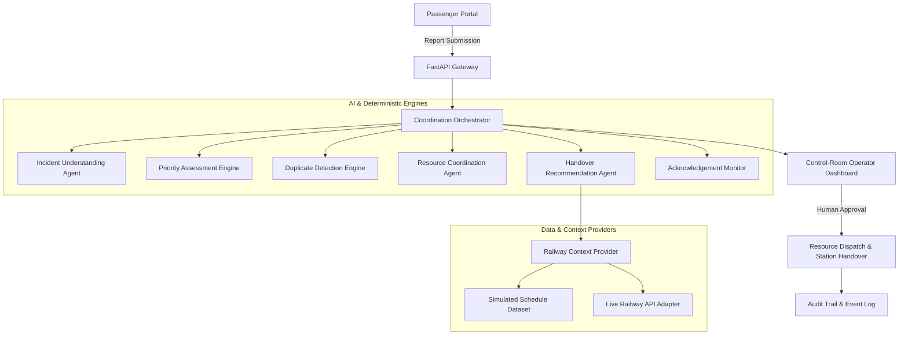

# RailResQ System Architecture

## 1. High-Level Concept
RailResQ is structured as an **Agentic Decision-Support Architecture** for railway emergency management.

## 2. Key Architecture Principles
1. **Human-in-the-Loop:** AI agents extract information, compute priority scores, and recommend handover plans, but human operators must review and confirm consequential actions.
2. **Deterministic Rules Over Blind LLMs:** Urgency calculation and priority rules are strictly deterministic. LLM outputs are structured and validated before ingestion.
3. **Dual Railway Context:** Explicitly separates **SIMULATED** mock data from **LIVE** external railway telemetry.
4. **Resilient Failover:** If an AI provider or external railway API is unavailable, the system fails over safely with clear indicator badges.
